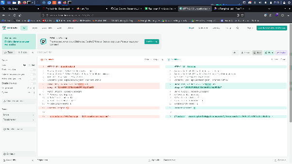
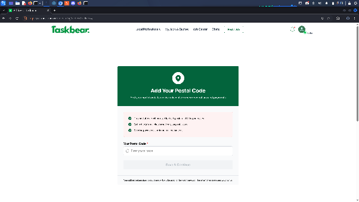

# OTP Verification Bypass via Response Tampering on Taskbear

## Title

OTP Verification Bypass on [Taskbear](http://taskbear.com.au) Signup

## Vulnerability Type

Authentication / OTP Verification Bypass

## Summary

The signup OTP verification flow on [taskbear.com.au](http://taskbear.com.au) may be bypassed by tampering with the HTTP response in the client-side testing proxy. During testing, an invalid OTP produced a 401 Unauthorized response, while a valid OTP produced a 201 Created response. Replacing the invalid-OTP response with the previously observed successful response caused the signup flow to proceed as if verification had succeeded.

## Vulnerable Endpoint

- Signup page: [Taskbear signup](https://taskbear.com.au/auth/sign-up?redirect=%2F)

## Steps to Reproduce

1. Open the TaskBear signup page and start Burp Suite.
2. Enter your test email address and request an OTP.
3. Enter an incorrect OTP and capture the response in Burp Suite. It shows `401 Unauthorized`.

## Proof of Concept

1. Take a temporary email address from [tempmail.cfd](http://tempmail.cfd).

   

2. Intercept the request using Burp Suite.

   

3. Enter an incorrect OTP, capture the response, and save it for comparison.

   

4. Repeat the previous step with the correct OTP and compare the responses.

   

5. Replace the `401` response with `201` and forward it. The signup flow then proceeds.

   

## Impact

If the behavior can be used to bypass server-side verification, an attacker may be able to:

- Complete signup without proving control of the email address.
- Register accounts using email addresses they do not control.
- Undermine workflows that rely on verified email ownership.

## Remediation

1. Treat OTP verification as a server-side security decision. Never rely on a client-controlled or intercepted response to establish verification.
2. Bind OTP verification to the correct signup session and contact address, and validate the OTP server-side on every attempt.
3. Issue a server-side verification state or signed, short-lived token only after successful OTP validation.
4. Ensure protected signup steps and account creation endpoints independently check the server-side verification state.
5. Add rate limiting, attempt limits, OTP expiration, and monitoring for repeated verification failures.
6. Add automated tests confirming that invalid, expired, reused, or mismatched OTPs cannot advance registration.
